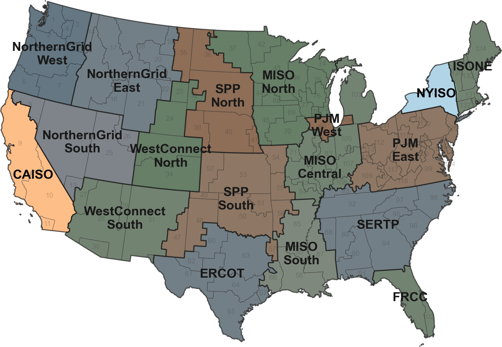
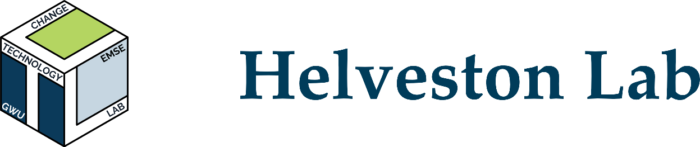

## EV sales in US reaching ~10% of sales {style="text-align: center;" .light-centered .center}

{fig-align="center" width="80%" .purple-border}

::: {style="width: 80%; margin: 0 auto; text-align: right; font-size: 24px;"}
Source: Argonne National Lab, [www.anl.gov/ev-facts/model-sales](https://www.anl.gov/ev-facts/model-sales)
:::

::: {.notes}
BEVs are now about one in ten new cars sold in the US. Millions of them come home in the evening and plug in at the same time, right on top of the existing grid peak. That is the problem this talk is about.
:::

## Introduction {.smaller .light-centered .center}

- **Unmanaged** BEV charging is becoming a problem to the grid.
- **Managed** charging is cheaper and smooths out the grid load.
- Supplier-Managed Charging (SMC) is a good approach.

{fig-align="center" width="65%" .purple-border}

::: {.notes}
Unmanaged charging adds a spike to the evening peak. Managed charging smooths that load and keeps costs down. Supplier-Managed Charging, or SMC, is a type of managed charging where the utility controls charging timing. This talk focuses on SMC.
:::

## SMC - Supplier Managed Charging {.light-centered .center}

::: {style="font-size: 32px;"}
- SMC smooths out the BEV charging spike (called "Peak-shaving").
- Electricity demand is controlled below the capacity threshold.
- It saves money and reduces pollution.
:::

{fig-align="center" width="90%"}

::: {.notes}
With unmanaged charging, the BEV load stacks on the evening peak and easily exceeds the capacity threshold. With SMC, the utility defers charging into the overnight valley, so total demand stays below the threshold. This is peak shaving. It saves money and reduces emissions from peaking generators.
:::

## Smart charging effectiveness depends on<br>[enrollment]{style="color: #2C8475;"} and [peak-shaving]{style="color: #2C8475;"}. {.light-centered .center}

```{=html}
<div style="width:84%;margin:0 auto;background-image:radial-gradient(circle,#E0DBE5 0.6px,transparent 0.6px);background-size:18px 18px;padding:1.4em 1em;border-radius:18px;margin-top:0.6em;">

 <div style="display:grid;grid-template-columns:1fr 1fr;gap:1.1em;align-items:stretch;">

  <div style="background:#FFFFFF;border:1px solid #BCDFC0;border-radius:16px;padding:1.1em 1.1em 1.2em;box-shadow:0 14px 32px rgba(44,132,117,0.18),0 2px 6px rgba(44,62,80,0.07);text-align:center;display:flex;flex-direction:column;align-items:center;gap:0.55em;">
   <div style="font-family:'Maple Mono',monospace;font-size:0.42em;letter-spacing:0.12em;text-transform:uppercase;font-weight:700;color:#2C8475;">Prior stage</div>
   <div style="width:2.5em;height:2.5em;border-radius:0.6em;background:#E5F2EE;border:1px solid #BCDFC0;display:flex;align-items:center;justify-content:center;color:#2C8475;"><i data-lucide="users" style="width:1.25em;height:1.25em;stroke-width:1.8;"></i></div>
   <div style="font-size:0.8em;font-weight:700;color:#2C8475;line-height:1.2;">Enrollment</div>
   <div style="font-size:0.58em;color:#564232;line-height:1.5;">Will BEV owners opt in,<br>and at what incentive?</div>
  </div>

  <div style="background:#E3EEFA;border:1px solid #A6C4EA;border-radius:16px;padding:1.1em 1.1em 1.2em;box-shadow:0 14px 32px rgba(58,125,201,0.18),0 2px 6px rgba(44,62,80,0.07);text-align:center;display:flex;flex-direction:column;align-items:center;gap:0.55em;">
   <div style="font-family:'Maple Mono',monospace;font-size:0.42em;letter-spacing:0.12em;text-transform:uppercase;font-weight:700;color:#3A7DC9;">Current stage</div>
   <div style="width:2.5em;height:2.5em;border-radius:0.6em;background:#FFFFFF;border:1px solid #A6C4EA;display:flex;align-items:center;justify-content:center;color:#3A7DC9;"><i data-lucide="chart-column-decreasing" style="width:1.25em;height:1.25em;stroke-width:1.8;"></i></div>
   <div style="font-size:0.8em;font-weight:700;color:#3A7DC9;line-height:1.2;">Peak-shaving</div>
   <div style="font-size:0.58em;color:#564232;line-height:1.5;">How much peak can SMC shave,<br>and at what cost?</div>
  </div>

 </div>

</div>
```

::: {.notes}
Two things decide whether SMC works at scale. First, enrollment: will BEV owners actually opt in, and what incentive does it take? That was our prior stage, a nationwide survey of BEV owners. Second, peak shaving: once people enroll, how much peak can SMC shave, and what does it cost the utility? That is the current stage. I will give you the prior stage in one slide, then spend the rest of the talk on the simulation.
:::

## Prior stage: willingness to enroll in SMC {.light-centered .center}

::: {style="font-size: 28px; margin-bottom: 0.5em;"}
[**Conjoint survey**]{style="color: #2C8475;"} of BEV owners [@hu_measuring_2025]
:::

```{=html}
<div style="width:96%;margin:0 auto;">

 <div style="display:grid;grid-template-columns:0.74fr 1.26fr;gap:1em;align-items:stretch;">

  <div style="display:flex;flex-direction:column;gap:0.7em;">

   <div style="flex:1;display:flex;align-items:center;gap:0.7em;background:#FFFFFF;border:1px solid #BCDFC0;border-radius:14px;padding:0.5em 0.9em;box-shadow:0 14px 32px rgba(44,132,117,0.14),0 2px 6px rgba(44,62,80,0.07);">
    <div style="width:1.9em;height:1.9em;border-radius:0.5em;background:#E5F2EE;border:1px solid #BCDFC0;display:flex;align-items:center;justify-content:center;color:#2C8475;flex-shrink:0;">
     <i data-lucide="users" style="width:1em;height:1em;stroke-width:1.8;"></i>
    </div>
    <div style="text-align:left;">
     <div style="font-size:0.85em;font-weight:700;color:#2C8475;line-height:1.1;">1,356</div>
     <div style="font-size:0.55em;color:#564232;line-height:1.3;">BEV owner responses</div>
    </div>
   </div>

   <div style="flex:1;display:flex;align-items:center;gap:0.7em;background:#FFFFFF;border:1px solid #F0DDB4;border-radius:14px;padding:0.5em 0.9em;box-shadow:0 14px 32px rgba(196,136,26,0.14),0 2px 6px rgba(44,62,80,0.07);">
    <div style="width:1.9em;height:1.9em;border-radius:0.5em;background:#FEF5E7;border:1px solid #F0DDB4;display:flex;align-items:center;justify-content:center;color:#C4881A;flex-shrink:0;">
     <i data-lucide="megaphone" style="width:1em;height:1em;stroke-width:1.8;"></i>
    </div>
    <div style="text-align:left;">
     <div style="font-size:0.85em;font-weight:700;color:#C4881A;line-height:1.1;">803 + 553</div>
     <div style="font-size:0.55em;color:#564232;line-height:1.3;">Meta Ads + Dynata, 2024</div>
    </div>
   </div>

   <div style="flex:1;display:flex;align-items:center;gap:0.7em;background:#FFFFFF;border:1px solid #C7C1E5;border-radius:14px;padding:0.5em 0.9em;box-shadow:0 14px 32px rgba(86,84,162,0.14),0 2px 6px rgba(44,62,80,0.07);">
    <div style="width:1.9em;height:1.9em;border-radius:0.5em;background:#EEEDF8;border:1px solid #C7C1E5;display:flex;align-items:center;justify-content:center;color:#5654A2;flex-shrink:0;">
     <i data-lucide="scale" style="width:1em;height:1em;stroke-width:1.8;"></i>
    </div>
    <div style="text-align:left;">
     <div style="font-size:0.85em;font-weight:700;color:#5654A2;line-height:1.1;">5 attributes</div>
     <div style="font-size:0.55em;color:#564232;line-height:1.3;">cash, overrides, battery thresholds</div>
    </div>
   </div>

  </div>

  <div style="display:flex;align-items:center;justify-content:center;background:#FFFFFF;border:1px solid #C7C1E5;border-radius:14px;padding:0.5em;box-shadow:0 14px 32px rgba(86,84,162,0.12),0 2px 6px rgba(44,62,80,0.07)">
   
  </div>

 </div>

</div>
```

::: {.notes}
The prior stage, published in Environmental Research Letters last year, is a conjoint survey of 1,356 real BEV owners, recruited through Meta ads and Dynata in 2024. Each respondent saw six choice questions like this one: two SMC programs that differ in enrollment cash, monthly cash, override allowance, and battery thresholds, plus a "not interested" option. Choosing between them reveals how much each feature is worth to them.
:::

## Existing studies assume enrollment is high and free {style="line-height: 1.5;" .light-centered .center}

1. Most grid studies **assume** optimal or near-100% participation [@tarroja_importance_2015; @coignard_clean_2018], <span style="color: #739C69">but real pilots enroll far fewer</span>.
2. Enrollment is **not free**: utilities must pay incentives [@bailey_show_2023; @wong_incentives_2023], <span style="color: #739C69">yet costs are rarely counted</span>.
3. Few studies compare peak-shaving **across grid regions** with different load shapes.

<br>

::: {.centered-container style="color: #2C3E50;"}
We connect [**consumer enrollment**]{style="color: #ED6D46;"} with [**grid simulation**]{style="color: #2980B9;"}.
:::

::: {.notes}
The technical potential of managed charging is well documented, but most studies assume everyone participates for free. In reality, participation depends on incentives, and incentives cost money. And few studies ask whether the answer changes with the shape of the grid. That is the gap: we bring the empirical enrollment curve into a grid-scale simulation of two contrasting regions.
:::

## Research Questions {style="line-height: 2;" .light-centered .center}

1. **Peak-shaving**: How much can SMC reduce peak demand in contrasting grid regions?

2. **Cost efficiency**: How much does peak shaving cost per unit, and is more enrollment always better?

<br>

::: {.approach}
[Approach]{.approach-title}

---

1. **Scenario-based simulation** for CAISO and NYISO.
2. **Enrollment curve** from the prior stage: incentives vs participation.
:::

::: {.notes}
Two research questions. First, the physical side: how much peak demand can SMC actually shave, and does the answer depend on the region? Second, the economic side: what does that peak shaving cost, and is pushing enrollment higher always worth it?

To answer them, we run a scenario-based simulation of CAISO and NYISO, and join it with the enrollment curve from the prior stage, which links incentive levels to participation rates.
:::

## Two contrasting regions: [CAISO]{style="color: #ED6D46;"} and [NYISO]{style="color: #739C69;"} {.light-centered .center}

```{=html}
<div style="width:96%;margin:0 auto;">

 

 <div style="border:1px solid #C7C1E5;border-radius:14px;padding:0;overflow:hidden;background:#FFFFFF;box-shadow:0 14px 32px rgba(86,84,162,0.12),0 2px 6px rgba(44,62,80,0.07);margin-top:0.5em;">
  <table style="width:100%;border-collapse:collapse;text-align:center;font-size:28px;margin:0;">
   <thead>
    <tr style="background-color:#EEEDF8;">
     <th style="width:16%;padding:10px 8px;border-bottom:2px solid #C4C3E8;border-right:1px solid #D4D3EE;"></th>
     <th style="width:21%;padding:10px 8px;border-bottom:2px solid #C4C3E8;border-right:1px solid #D4D3EE;">Single families</th>
     <th style="width:21%;padding:10px 8px;border-bottom:2px solid #C4C3E8;border-right:1px solid #D4D3EE;">Energy source</th>
     <th style="width:21%;padding:10px 8px;border-bottom:2px solid #C4C3E8;border-right:1px solid #D4D3EE;">Net load shape</th>
     <th style="width:21%;padding:10px 8px;border-bottom:2px solid #C4C3E8;">Seasonal effect</th>
    </tr>
   </thead>
   <tbody>
    <tr>
     <td style="padding:10px 8px;border-right:1px solid #D4D3EE;background-color:#EEEDF8;font-weight:700;color:#ED6D46;">CAISO</td>
     <td style="padding:10px 8px;border-right:1px solid #D4D3EE;">7.69 million</td>
     <td style="padding:10px 8px;border-right:1px solid #D4D3EE;">Solar</td>
     <td style="padding:10px 8px;border-right:1px solid #D4D3EE;">"Duck curve"</td>
     <td style="padding:10px 8px;">Minimal</td>
    </tr>
    <tr>
     <td style="padding:10px 8px;border-top:1px solid #D4D3EE;border-right:1px solid #D4D3EE;background-color:#EEEDF8;font-weight:700;color:#739C69;">NYISO</td>
     <td style="padding:10px 8px;border-top:1px solid #D4D3EE;border-right:1px solid #D4D3EE;">3.16 million</td>
     <td style="padding:10px 8px;border-top:1px solid #D4D3EE;border-right:1px solid #D4D3EE;">Hydro</td>
     <td style="padding:10px 8px;border-top:1px solid #D4D3EE;border-right:1px solid #D4D3EE;">Flat profile</td>
     <td style="padding:10px 8px;border-top:1px solid #D4D3EE;">Strong in winter</td>
    </tr>
   </tbody>
  </table>
 </div>

 <div style="text-align:center;font-size:28px;margin-top:0.6em;">Both <strong>lead in BEV adoption</strong>, with <strong>contrasting grid structures</strong>.</div>

</div>
```

::: {.notes}
The US grid divides into 18 regions. We picked California and New York because they are both BEV leaders but structurally opposite grids. CAISO has the solar duck curve with a steep evening ramp, and it behaves essentially the same across all four seasons. NYISO is flatter, relies more on dispatchable hydro, and is season-sensitive: winter overnight heating keeps the nighttime load elevated, which matters later in the results. This contrast lets us see how grid context shapes SMC performance.
:::

## Simulation Overview {.light-centered .center}

{fig-align="center" width="100%" .purple-border}

::: {.notes}
The framework has two parts. The first is the peak-shaving model: three data sources feed a simulation that sweeps TOU window configurations, adoption rates, date ranges, and enrollment levels from 0 to 100 percent. The second takes the best-performing outcomes and joins them with the consumer enrollment curve to compute cost efficiency frontiers. Let me walk through the key steps.
:::

## Step 1: BEV Charging Load Profile {.light-centered .center}

{fig-align="center" width="85%" .purple-border}

::: {style="font-size: 30px;"}
Simulation of 10,000 vehicles based on ~26,000 trip records from 2022 NHTS.
:::

::: {.notes}
Step one builds the unmanaged BEV charging load from about 26,000 travel records in the 2022 NHTS. We simulate 10,000 vehicles with 200-mile range on Level 2 home charging, keeping batteries between 20 and 80 percent. People come home in the evening and plug in, so the load peaks at 7 PM, exactly on top of the existing grid evening peak. All plots start at 7 AM so the evening peak sits in the center and the overnight valley forms one block on the right.
:::

## Step 2: BEV Load Peak Shaving {.light-centered .center}

{fig-align="center" width="85%" .purple-border}

::: {style="font-size: 28px;"}
**Five configurations** with different peak/valley windows.
:::

::: {.notes}
Step two shifts that load. From 10 AM, charging is suppressed unless the battery would fall below 20 percent or tomorrow's travel would be at risk; deferred demand is delivered at maximum rate once the valley window opens. Sessions that cannot be shifted stay in place as override events, which stay within 2 to 3 per vehicle per month. The five configurations differ only in when the valley opens, from 8 PM to midnight. This is drawn at 50 percent enrollment so you can see half of the fleet shifted and half charging as usual. The appendix compares the five windows: the 11 PM valley start performs best, so all results use it.
:::

## Step 3: Net Load + BEV & Peak Shaving {.light-centered .center}

{fig-align="center" width="85%" .purple-border}

::: {style="font-size: 28px;"}
BEV load scaled to fleet size and stacked on net load.
:::

::: {.notes}
Step three scales the BEV load to the fleet and stacks it on the grid net load, the shaded area. We assume one BEV per detached single-family household, so each simulated vehicle represents 769 vehicles in CAISO and 316 in NYISO. The black line is total load with no SMC; the green line is full enrollment: the evening peak drops and the load moves into the overnight valley.
:::

## Enrollment Curve from Prior Stage {.light-centered .center}

{fig-align="center" width="85%" .purple-border}

::: {style="font-size: 28px;"}
Mixed logit prediction based on 1,356 real BEV owners.
:::

::: {.notes}
This is the bridge between the two studies. The mixed logit model, holding non-monetary attributes fixed, gives the enrollment rate as a function of the monthly incentive. About 30 percent would participate with no payment at all, 20 dollars a month gets you to about 60 percent, but full enrollment would take 85 dollars per household per month. The curve is concave, and since utilities pay a uniform incentive to everyone, total program cost grows non-linearly with enrollment.
:::

## Peak Shaving: Annual Average {.light-centered .center}

::: {style="border: 1px solid #C7C1E5; border-radius: 14px; padding: 0; overflow: hidden; background: #FFFFFF; box-shadow: 0 14px 32px rgba(86, 84, 162, 0.12), 0 2px 6px rgba(44, 62, 80, 0.07);"}

<table style="width: 100%; border-collapse: collapse; text-align: center; font-size: 30px; margin: 0;">
  <thead>
    <tr style="background-color: #EEEDF8;">
      <th colspan="2" style="width: 50%; padding: 12px 10px; border-right: 1px solid #D4D3EE; border-bottom: 2px solid #C4C3E8; font-size: 32px; color: #ED6D46; text-align: center;">CAISO</th>
      <th colspan="2" style="width: 50%; padding: 12px 10px; border-bottom: 2px solid #C4C3E8; font-size: 32px; color: #739C69; text-align: center;">NYISO</th>
    </tr>
  </thead>
  <tbody>
    <tr>
      <td colspan="2" style="padding: 10px; border-right: 1px solid #D4D3EE; text-align: center;"></td>
      <td colspan="2" style="padding: 10px; text-align: center;"></td>
    </tr>
    <tr>
      <td style="width: 17%; padding: 14px 10px; border-top: 1px solid #D4D3EE; border-right: 1px solid #D4D3EE; background-color: #EEEDF8;"><strong>Peak shave</strong></td>
      <td style="width: 33%; padding: 14px 10px; border-top: 1px solid #D4D3EE; border-right: 1px solid #D4D3EE; text-align: center;">3.7 GW (30.5 → 26.8)</td>
      <td style="width: 17%; padding: 14px 10px; border-top: 1px solid #D4D3EE; border-right: 1px solid #D4D3EE; background-color: #EEEDF8;"><strong>Peak shave</strong></td>
      <td style="width: 33%; padding: 14px 10px; border-top: 1px solid #D4D3EE; text-align: center;">1.6 GW (21.2 → 19.6)</td>
    </tr>
    <tr>
      <td style="padding: 14px 10px; border-top: 1px solid #D4D3EE; border-right: 1px solid #D4D3EE; background-color: #EEEDF8;"><strong>Percentage</strong></td>
      <td style="padding: 14px 10px; border-top: 1px solid #D4D3EE; border-right: 1px solid #D4D3EE; text-align: center;">12.1%</td>
      <td style="padding: 14px 10px; border-top: 1px solid #D4D3EE; border-right: 1px solid #D4D3EE; background-color: #EEEDF8;"><strong>Percentage</strong></td>
      <td style="padding: 14px 10px; border-top: 1px solid #D4D3EE; text-align: center;">7.5%</td>
    </tr>
  </tbody>
</table>

:::

::: {.notes}
Now the results. On an annual average day with full enrollment, SMC shaves 3.7 gigawatts off CAISO's evening peak, about 12 percent, and 1.6 gigawatts in NYISO, about 7.5 percent. CAISO does better both because it has more households and because its deep overnight valley absorbs the deferred charging.
:::

## Peak Shaving: [CAISO]{style="color: #ED6D46;"} Extreme Days {.light-centered .center}

::: {style="border: 1px solid #C7C1E5; border-radius: 14px; padding: 0; overflow: hidden; background: #FFFFFF; box-shadow: 0 14px 32px rgba(86, 84, 162, 0.12), 0 2px 6px rgba(44, 62, 80, 0.07);"}

<table style="width: 100%; border-collapse: collapse; font-size: 30px; margin: 0;">
  <thead>
    <tr style="background-color: #EEEDF8;">
      <th colspan="2" style="width: 50%; padding: 12px 10px; border-right: 1px solid #D4D3EE; border-bottom: 2px solid #C4C3E8; font-size: 32px; color: #2980B9; text-align: center;">Best Day (Jun 1)</th>
      <th colspan="2" style="width: 50%; padding: 12px 10px; border-bottom: 2px solid #C4C3E8; font-size: 32px; color: #E74C3C; text-align: center;">Worst Day (Dec 13)</th>
    </tr>
  </thead>
  <tbody>
    <tr>
      <td colspan="2" style="padding: 10px; border-right: 1px solid #D4D3EE; text-align: center;"></td>
      <td colspan="2" style="padding: 10px; text-align: center;"></td>
    </tr>
    <tr>
      <td style="width: 17%; padding: 14px 10px; border-top: 1px solid #D4D3EE; border-right: 1px solid #D4D3EE; background-color: #EEEDF8;"><strong>Peak shave</strong></td>
      <td style="width: 33%; padding: 14px 10px; border-top: 1px solid #D4D3EE; border-right: 1px solid #D4D3EE; text-align: center;">5.4 GW (37.6 → 32.2)</td>
      <td style="width: 17%; padding: 14px 10px; border-top: 1px solid #D4D3EE; border-right: 1px solid #D4D3EE; background-color: #EEEDF8;"><strong>Peak shave</strong></td>
      <td style="width: 33%; padding: 14px 10px; border-top: 1px solid #D4D3EE; text-align: center;">1.9 GW (30.7 → 28.8)</td>
    </tr>
    <tr>
      <td style="padding: 14px 10px; border-top: 1px solid #D4D3EE; border-right: 1px solid #D4D3EE; background-color: #EEEDF8;"><strong>Percentage</strong></td>
      <td style="padding: 14px 10px; border-top: 1px solid #D4D3EE; border-right: 1px solid #D4D3EE; text-align: center;">14.4%</td>
      <td style="padding: 14px 10px; border-top: 1px solid #D4D3EE; border-right: 1px solid #D4D3EE; background-color: #EEEDF8;"><strong>Percentage</strong></td>
      <td style="padding: 14px 10px; border-top: 1px solid #D4D3EE; text-align: center;">6.2%</td>
    </tr>
  </tbody>
</table>

:::

::: {.notes}
Performance varies a lot day to day. CAISO's best day shaves 5.4 gigawatts, its worst under 2. One nuance: extreme days are ranked by how much peak can be shaved, not by how high the peak is. On heat-wave days, air conditioning dominates and BEV charging is a small share, so SMC has less leverage.
:::

## Peak Shaving: [NYISO]{style="color: #739C69;"} Extreme Days {.light-centered .center}

::: {style="border: 1px solid #C7C1E5; border-radius: 14px; padding: 0; overflow: hidden; background: #FFFFFF; box-shadow: 0 14px 32px rgba(86, 84, 162, 0.12), 0 2px 6px rgba(44, 62, 80, 0.07);"}

<table style="width: 100%; border-collapse: collapse; font-size: 30px; margin: 0;">
  <thead>
    <tr style="background-color: #EEEDF8;">
      <th colspan="2" style="width: 50%; padding: 12px 10px; border-right: 1px solid #D4D3EE; border-bottom: 2px solid #C4C3E8; font-size: 32px; color: #2980B9; text-align: center;">Best Day (Jul 13)</th>
      <th colspan="2" style="width: 50%; padding: 12px 10px; border-bottom: 2px solid #C4C3E8; font-size: 32px; color: #E74C3C; text-align: center;">Worst Day (Nov 8)</th>
    </tr>
  </thead>
  <tbody>
    <tr>
      <td colspan="2" style="padding: 10px; border-right: 1px solid #D4D3EE; text-align: center;"></td>
      <td colspan="2" style="padding: 10px; text-align: center;"></td>
    </tr>
    <tr>
      <td style="width: 17%; padding: 14px 10px; border-top: 1px solid #D4D3EE; border-right: 1px solid #D4D3EE; background-color: #EEEDF8;"><strong>Peak shave</strong></td>
      <td style="width: 33%; padding: 14px 10px; border-top: 1px solid #D4D3EE; border-right: 1px solid #D4D3EE; text-align: center;">2.2 GW (27.8 → 25.6)</td>
      <td style="width: 17%; padding: 14px 10px; border-top: 1px solid #D4D3EE; border-right: 1px solid #D4D3EE; background-color: #EEEDF8;"><strong>Peak shave</strong></td>
      <td style="width: 33%; padding: 14px 10px; border-top: 1px solid #D4D3EE; text-align: center;">0.8 GW (17.8 → 17.0)</td>
    </tr>
    <tr>
      <td style="padding: 14px 10px; border-top: 1px solid #D4D3EE; border-right: 1px solid #D4D3EE; background-color: #EEEDF8;"><strong>Percentage</strong></td>
      <td style="padding: 14px 10px; border-top: 1px solid #D4D3EE; border-right: 1px solid #D4D3EE; text-align: center;">7.9%</td>
      <td style="padding: 14px 10px; border-top: 1px solid #D4D3EE; border-right: 1px solid #D4D3EE; background-color: #EEEDF8;"><strong>Percentage</strong></td>
      <td style="padding: 14px 10px; border-top: 1px solid #D4D3EE; text-align: center;">4.5%</td>
    </tr>
  </tbody>
</table>

:::

::: {.notes}
NYISO's range is narrower: the best day shaves 2.2 gigawatts, the worst 0.8. Smaller absolute numbers because there are fewer households, and smaller percentages because the net load varies less over the day.
:::

## Peak from BEV charging decreases with higher enrollment {.light-centered style="font-size: 0.85em;" .center}

{fig-align="center" width="100%" .purple-border}

::: {.notes}
Monthly incentive per household versus achieved peak reduction on the annual average day. Each dot is a 10 percent enrollment step. Peak reduction grows with enrollment in both regions, but the dots spread out along the incentive axis at higher enrollment. Joining this with the enrollment curve gives the cost efficiency frontier on the next slide.
:::

## Cost Efficiency Frontier {.light-centered .center}

::: {.columns}
::: {.column}
{fig-align="center" width="100%" .purple-border}
:::

::: {.column}
{fig-align="center" width="100%" .purple-border}
:::
:::

::: {style="text-align: center; font-size: 28px;"}
Cost efficiency is highest at moderate enrollment (**30–50%**).
:::

::: {.notes}
Here is the central result. We join the enrollment curve with the peak-shaving results. Each curve is one day type: least, average, and most peak shaving. Each dot is a 10 percent enrollment step, from 30 percent at zero incentive to 100 percent. The gray arrow shows the monthly incentive per household behind each dot, from 0 to 85 dollars. The dots stretch out along the cost axis: attracting marginal participants means raising the payment for every existing enrollee, so the last increments of enrollment are extremely expensive. Moderate enrollment, 30 to 50 percent, captures most of the achievable peak reduction at a fraction of the cost. And on about 15 percent of CAISO days, pushing enrollment too high actually creates a new overnight peak.
:::

## Seasonal cost efficiency is<br>consistent in CAISO, but varies in NYISO. {.light-centered style="font-size: 0.85em;" .center}

::: {.columns}
::: {.column}
{fig-align="center" width="100%" .purple-border}
:::

::: {.column}
{fig-align="center" width="100%" .purple-border}
:::
:::

::: {.notes}
By season, CAISO's four curves nearly overlap, so a year-round program delivers consistent value: the solar-shaped profile keeps the peak-to-valley gap wide in every season. NYISO's winter curve sits below the others at every enrollment level, because overnight space heating keeps the valley elevated and leaves less room for deferred charging. Utilities there may need seasonal enrollment targets or incentive levels.
:::

## Most program cost is participant surplus {.light-centered .center}

{fig-align="center" width="92%" .purple-border}

::: {style="text-align: center; font-size: 28px;"}
**72–92%** of uniform payments exceed what enrolled households would accept.
:::

::: {.notes}
One more angle on cost. The program pays the same incentive to every enrolled household, but the enrollment curve tells us each household's minimum: roughly a third would join for nothing. The dashed line is what the program would pay if each household got exactly its minimum. The gap is participant surplus, and it is 72 to 92 percent of program cost. At 60 percent enrollment in CAISO, the program pays 92 million a month, while the enrolled households would accept 21 million. No program can pay the minimum, since each household's number is private, but it bounds what tiered menus or enrollment auctions could save.
:::

## Conclusions {.light-centered .center}

::: {style="border: 1px solid #C7C1E5; border-radius: 14px; padding: 0; overflow: hidden; background: #FFFFFF; box-shadow: 0 14px 32px rgba(86, 84, 162, 0.12), 0 2px 6px rgba(44, 62, 80, 0.07);"}

<table style="width: 100%; border-collapse: collapse; font-size: 28px; margin: 0;">
  <tbody>
    <tr>
      <td colspan="2" style="padding: 16px 14px; text-align: left;"><span style="display: flex;"><span style="white-space: pre;">1\. </span><span><strong style="color: #ED6D46;">Peak-shaving</strong> potential is:<br>up to 14.4% (5.4 GW) for CAISO, and 7.9% (2.2 GW) for NYISO.</span></span></td>
    </tr>
    <tr>
      <td colspan="2" style="padding: 16px 14px; border-top: 1px solid #D4D3EE; text-align: left;"><span style="display: flex;"><span style="white-space: pre;">2\. </span><span>The <strong style="color: #2980B9;">cost-effectiveness</strong> of peak shaving requires:<br>moderate enrollment (30–50%), and seasonal effect consideration.</span></span></td>
    </tr>
    <tr>
      <td colspan="2" style="padding: 16px 14px; border-top: 1px solid #D4D3EE; text-align: left;"><span style="display: flex;"><span style="white-space: pre;">3\. </span><span>Most program cost is <strong style="color: #739C69;">participant surplus</strong> (72–92%):<br>better-targeted incentives could deliver the same shaving for less.</span></span></td>
    </tr>
    <tr>
      <td style="width: 20%; padding: 16px 14px; border-top: 1px solid #D4D3EE; border-right: 1px solid #D4D3EE; background-color: #EEEDF8; text-align: center;"><strong style="color: #F07167;">Limitations</strong></td>
      <td style="width: 80%; padding: 16px 14px; border-top: 1px solid #D4D3EE; text-align: left;">a\. Stated preference might be optimistic.<br>b\. Only considered single-family homes.<br>c\. Grid conditions based on 2025 data.</td>
    </tr>
  </tbody>
</table>

:::

::: {.notes}
Three takeaways. First, the magnitude: SMC shaves up to 14.4 percent off CAISO's evening peak and 7.9 percent off NYISO's. CAISO does better because its deep overnight valley absorbs the deferred charging.

Second, cost. Returns to enrollment diminish sharply: 30 to 50 percent participation captures most of the achievable reduction at a fraction of the cost, and pushing too high can create a new overnight peak. Utilities should design SMC programs around moderate enrollment targets, not maximum participation, and in NYISO account for weaker winter performance.

Third, most of what a uniform incentive pays is participant surplus, so better-targeted designs could lower the cost of the same peak shaving.

Beyond these, SMC has co-benefits we did not monetize: lower marginal emissions, longer battery life, and deferred capacity investment, so the frontiers are a lower bound on its value. And as grid storage grows, SMC stays a complement: storage reshapes the baseline, SMC removes the peak that BEV charging adds on top.

Limitations: the enrollment curve is stated preference, so it may overstate real uptake and our costs may be a lower bound. We model single-family homes only, which matters for New York City. And results are calibrated to 2025 net load.
:::

## Acknowledgments {.light-centered .center}

```{=html}
<div style="width:88%;margin:0 auto;background-image:radial-gradient(circle,#E0DBE5 0.6px,transparent 0.6px);background-size:18px 18px;padding:1.1em 1.2em;border-radius:18px;font-size:0.9em;">

 <div style="display:flex;flex-direction:column;gap:0.5em;">

  <div style="display:flex;align-items:center;gap:0.8em;background:#FFFFFF;border:1px solid #C7C1E5;border-radius:14px;padding:0.45em 1em;box-shadow:0 14px 32px rgba(86,84,162,0.14),0 2px 6px rgba(44,62,80,0.07);">
   <div style="width:1.9em;height:1.9em;border-radius:0.5em;background:#EEEDF8;border:1px solid #C7C1E5;display:flex;align-items:center;justify-content:center;color:#5654A2;flex-shrink:0;">
    <i data-lucide="users" style="width:1em;height:1em;stroke-width:1.8;"></i>
   </div>
   <div style="text-align:left;">
    <div style="font-family:'Maple Mono',monospace;font-size:0.52em;letter-spacing:0.12em;text-transform:uppercase;font-weight:700;color:#5654A2;">Co-authors</div>
    <div style="font-size:0.6em;font-weight:700;color:#2C3E50;line-height:1.25;">Brian Tarroja, Matthew Dean, Kate Forrest (UC Irvine) &middot; Eric Hittinger (RIT) &middot; Alan Jenn (UC Davis) &middot; John Paul Helveston (GWU)</div>
   </div>
  </div>

  <div style="display:flex;align-items:center;gap:0.8em;background:#FFFFFF;border:1px solid #F0DDB4;border-radius:14px;padding:0.45em 1em;box-shadow:0 14px 32px rgba(196,136,26,0.14),0 2px 6px rgba(44,62,80,0.07);">
   <div style="width:1.9em;height:1.9em;border-radius:0.5em;background:#FEF5E7;border:1px solid #F0DDB4;display:flex;align-items:center;justify-content:center;color:#C4881A;flex-shrink:0;">
    <i data-lucide="handshake" style="width:1em;height:1em;stroke-width:1.8;"></i>
   </div>
   <div style="text-align:left;">
    <div style="font-family:'Maple Mono',monospace;font-size:0.52em;letter-spacing:0.12em;text-transform:uppercase;font-weight:700;color:#C4881A;">Funding</div>
    <div style="font-size:0.6em;font-weight:700;color:#2C3E50;line-height:1.25;">Alfred P. Sloan Foundation (grant G-2023-20976) &middot; Helveston Lab, George Washington University</div>
   </div>
  </div>

  <div style="display:flex;align-items:center;gap:0.8em;background:#FFFFFF;border:1px solid #BCDFC0;border-radius:14px;padding:0.45em 1em;box-shadow:0 14px 32px rgba(44,132,117,0.14),0 2px 6px rgba(44,62,80,0.07);">
   <div style="width:1.9em;height:1.9em;border-radius:0.5em;background:#E5F2EE;border:1px solid #BCDFC0;display:flex;align-items:center;justify-content:center;color:#2C8475;flex-shrink:0;">
    <i data-lucide="plug-zap" style="width:1em;height:1em;stroke-width:1.8;"></i>
   </div>
   <div style="text-align:left;">
    <div style="font-family:'Maple Mono',monospace;font-size:0.52em;letter-spacing:0.12em;text-transform:uppercase;font-weight:700;color:#2C8475;">Utility partners</div>
    <div style="font-size:0.6em;font-weight:700;color:#2C3E50;line-height:1.25;">Southern California Edison &middot; Pacific Gas &amp; Electric &middot; National Grid</div>
   </div>
  </div>

  <div style="display:flex;align-items:center;gap:0.8em;background:#FFFFFF;border:1px solid #A6C4EA;border-radius:14px;padding:0.45em 1em;box-shadow:0 14px 32px rgba(58,125,201,0.14),0 2px 6px rgba(44,62,80,0.07);">
   <div style="width:1.9em;height:1.9em;border-radius:0.5em;background:#DCE9FA;border:1px solid #A6C4EA;display:flex;align-items:center;justify-content:center;color:#3A7DC9;flex-shrink:0;">
    <i data-lucide="folder-git-2" style="width:1em;height:1em;stroke-width:1.8;"></i>
   </div>
   <div style="text-align:left;">
    <div style="font-family:'Maple Mono',monospace;font-size:0.52em;letter-spacing:0.12em;text-transform:uppercase;font-weight:700;color:#3A7DC9;">Data &amp; code</div>
    <div style="font-size:0.6em;font-weight:700;color:#2C3E50;line-height:1.25;"><a href="https://github.com/pingfan-hu/2025-grid-peak-shaving-public" target="_blank" rel="noopener" style="font-family:'Maple Mono',monospace;">github.com/pingfan-hu/2025-grid-peak-shaving-public</a></div>
   </div>
  </div>

 </div>

 <div style="height:1px;background:linear-gradient(90deg,transparent,#C4C3E8,transparent);margin-top:1em;"></div>

 <div style="display:flex;align-items:center;justify-content:center;gap:1.5em;margin-top:0.9em;">
  
  <div style="width:1px;height:2em;background:#2C3E50;opacity:0.35;"></div>
  
 </div>

</div>
```

::: {.notes}
This work is a collaboration across GWU, UC Irvine, RIT, and UC Davis, supported by the Alfred P. Sloan Foundation. Thanks to Southern California Edison, PG&E, and National Grid for their insights on utility program perspectives. All data, code, and simulation outputs are public on GitHub.
:::

## Thanks for listening! {.dark-centered .center}

```{=html}
<div style="width:66%;margin:0 auto;">

 <a class="thanks-card" href="https://pingfan.org" target="_blank" rel="noopener" style="flex-direction:row;align-items:center;gap:0.8em;padding:0.8em 1.2em;margin-top:1.2em;width:100%;box-sizing:border-box;">
  <div style="width:3em;height:3em;border-radius:50%;background-image:url('figs/pingfan-2.png');flex-shrink:0;background-size:cover;background-position:center;border:1.5px solid #DCE9FA;box-shadow:0 3px 10px rgba(58,125,201,0.15);"></div>
  <div style="display:flex;flex-direction:column;gap:0.15em;">
   <div style="font-size:0.8em;font-weight:700;color:#2C3E50;white-space:nowrap;line-height:1.2;">Pingfan Hu</div>
   <div style="font-size:0.5em;color:#564232;white-space:nowrap;">George Washington University</div>
  </div>
  <span class="instructor-link instructor-link--blue" style="margin-left:auto;align-self:center;font-size:0.6em;padding:0.32em 0.85em;border:1.5px solid #3A7DC9;">pingfan.org</span>
 </a>

 <div style="width:70%;height:2px;margin:1.2em auto 0;border-radius:999px;background:linear-gradient(90deg,transparent,rgba(196,195,232,0.45),transparent);"></div>

 <div class="thanks-nav" style="display:flex;background:#EFECE1;border-radius:999px;margin-top:1.2em;box-shadow:0 6px 22px rgba(0,0,0,0.2);overflow:hidden;">

  <a href="https://pingfan.org/about.html" target="_blank" rel="noopener" style="flex:1;display:flex;align-items:center;justify-content:center;gap:0.4em;padding:0.55em 0;text-decoration:none;">
   <svg xmlns="http://www.w3.org/2000/svg" viewBox="0 0 24 24" fill="none" stroke="#2C3E50" stroke-width="2" stroke-linecap="round" stroke-linejoin="round" style="width:0.75em;height:0.75em;flex-shrink:0;"><circle cx="12" cy="12" r="10"/><circle cx="12" cy="10" r="3"/><path d="M7 20.662V19a2 2 0 0 1 2-2h6a2 2 0 0 1 2 2v1.662"/></svg>
   <span style="font-size:0.5em;font-weight:700;color:#2C3E50;">About</span>
  </a>

  <div style="width:1px;background:rgba(44,62,80,0.18);margin:0.5em 0;"></div>

  <a href="https://pingfan.org/blog.html" target="_blank" rel="noopener" style="flex:1;display:flex;align-items:center;justify-content:center;gap:0.4em;padding:0.55em 0;text-decoration:none;">
   <svg xmlns="http://www.w3.org/2000/svg" viewBox="0 0 24 24" fill="none" stroke="#2C3E50" stroke-width="2" stroke-linecap="round" stroke-linejoin="round" style="width:0.75em;height:0.75em;flex-shrink:0;"><path d="M15 2H6a2 2 0 0 0-2 2v16a2 2 0 0 0 2 2h12a2 2 0 0 0 2-2V7Z"/><path d="M14 2v4a2 2 0 0 0 2 2h4"/><path d="M10 9H8"/><path d="M16 13H8"/><path d="M16 17H8"/></svg>
   <span style="font-size:0.5em;font-weight:700;color:#2C3E50;">Blog</span>
  </a>

  <div style="width:1px;background:rgba(44,62,80,0.18);margin:0.5em 0;"></div>

  <a href="https://pingfan.org/research" target="_blank" rel="noopener" style="flex:1;display:flex;align-items:center;justify-content:center;gap:0.4em;padding:0.55em 0;text-decoration:none;">
   <svg xmlns="http://www.w3.org/2000/svg" viewBox="0 0 24 24" fill="none" stroke="#2C3E50" stroke-width="2" stroke-linecap="round" stroke-linejoin="round" style="width:0.75em;height:0.75em;flex-shrink:0;"><path d="M3 3v16a2 2 0 0 0 2 2h16"/><path d="M18 17V9"/><path d="M13 17V5"/><path d="M8 17v-3"/></svg>
   <span style="font-size:0.5em;font-weight:700;color:#2C3E50;">Research</span>
  </a>

  <div style="width:1px;background:rgba(44,62,80,0.18);margin:0.5em 0;"></div>

  <a href="https://pingfan.org/works.html" target="_blank" rel="noopener" style="flex:1;display:flex;align-items:center;justify-content:center;gap:0.4em;padding:0.55em 0;text-decoration:none;">
   <svg xmlns="http://www.w3.org/2000/svg" viewBox="0 0 24 24" fill="none" stroke="#2C3E50" stroke-width="2" stroke-linecap="round" stroke-linejoin="round" style="width:0.75em;height:0.75em;flex-shrink:0;"><path d="m16 6 4 14"/><path d="M12 6v14"/><path d="M8 8v12"/><path d="M4 4v16"/></svg>
   <span style="font-size:0.5em;font-weight:700;color:#2C3E50;">Works</span>
  </a>

 </div>

</div>
```



## Reference List {.center}
