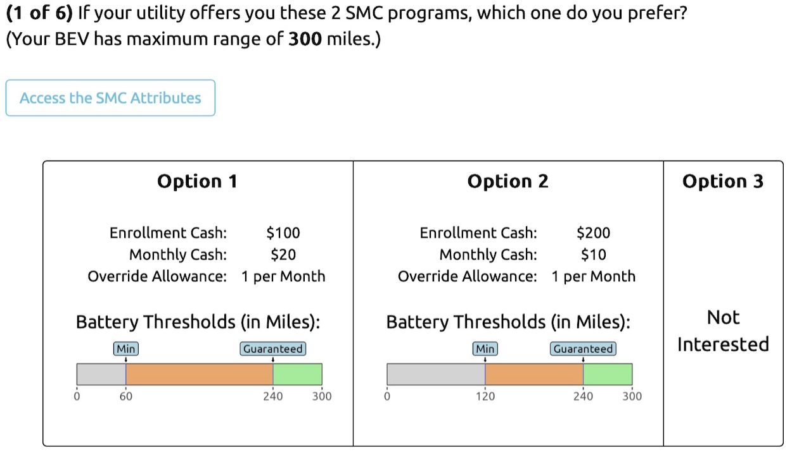
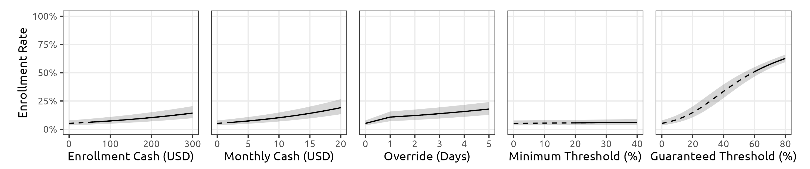

## Prior study: willingness to enroll in SMC {.light-centered .center}

::: {style="font-size: 28px; margin-bottom: 0.5em;"}
[**Conjoint survey**]{style="color: #2C8475;"} of BEV owners [@hu_measuring_2025]
:::

```{=html}
<div style="width:96%;margin:0 auto;">

 <div style="display:grid;grid-template-columns:0.74fr 1.26fr;gap:1em;align-items:stretch;">

  <div style="display:flex;flex-direction:column;gap:0.7em;">

   <div style="flex:1;display:flex;align-items:center;gap:0.7em;background:#FFFFFF;border:1px solid #BCDFC0;border-radius:14px;padding:0.5em 0.9em;box-shadow:0 14px 32px rgba(44,132,117,0.14),0 2px 6px rgba(44,62,80,0.07);">
    <div style="width:1.9em;height:1.9em;border-radius:0.5em;background:#E5F2EE;border:1px solid #BCDFC0;display:flex;align-items:center;justify-content:center;color:#2C8475;flex-shrink:0;">
     <i data-lucide="users" style="width:1em;height:1em;stroke-width:1.8;"></i>
    </div>
    <div style="text-align:left;">
     <div style="font-size:0.85em;font-weight:700;color:#2C8475;line-height:1.1;">1,356</div>
     <div style="font-size:0.55em;color:#564232;line-height:1.3;">BEV owner responses</div>
    </div>
   </div>

   <div style="flex:1;display:flex;align-items:center;gap:0.7em;background:#FFFFFF;border:1px solid #F0DDB4;border-radius:14px;padding:0.5em 0.9em;box-shadow:0 14px 32px rgba(196,136,26,0.14),0 2px 6px rgba(44,62,80,0.07);">
    <div style="width:1.9em;height:1.9em;border-radius:0.5em;background:#FEF5E7;border:1px solid #F0DDB4;display:flex;align-items:center;justify-content:center;color:#C4881A;flex-shrink:0;">
     <i data-lucide="megaphone" style="width:1em;height:1em;stroke-width:1.8;"></i>
    </div>
    <div style="text-align:left;">
     <div style="font-size:0.85em;font-weight:700;color:#C4881A;line-height:1.1;">803 + 553</div>
     <div style="font-size:0.55em;color:#564232;line-height:1.3;">Meta Ads + Dynata, 2024</div>
    </div>
   </div>

   <div style="flex:1;display:flex;align-items:center;gap:0.7em;background:#FFFFFF;border:1px solid #C7C1E5;border-radius:14px;padding:0.5em 0.9em;box-shadow:0 14px 32px rgba(86,84,162,0.14),0 2px 6px rgba(44,62,80,0.07);">
    <div style="width:1.9em;height:1.9em;border-radius:0.5em;background:#EEEDF8;border:1px solid #C7C1E5;display:flex;align-items:center;justify-content:center;color:#5654A2;flex-shrink:0;">
     <i data-lucide="scale" style="width:1em;height:1em;stroke-width:1.8;"></i>
    </div>
    <div style="text-align:left;">
     <div style="font-size:0.85em;font-weight:700;color:#5654A2;line-height:1.1;">5 attributes</div>
     <div style="font-size:0.55em;color:#564232;line-height:1.3;">cash, overrides, battery thresholds</div>
    </div>
   </div>

  </div>

  <div style="display:flex;align-items:center;justify-content:center;background:#FFFFFF;border:1px solid #C7C1E5;border-radius:14px;padding:0.5em;box-shadow:014px32pxrgba(86,84,162,0.12),02px6pxrgba(44,62,80,0.07)">
   
  </div>

 </div>

</div>
```

::: {.notes}
The prior study, published in Environmental Research Letters last year, is a conjoint survey of 1,356 real BEV owners, recruited through Meta ads and Dynata in 2024. Each respondent saw six choice questions like this one: two SMC programs that differ in enrollment cash, monthly cash, override allowance, and battery thresholds, plus a "not interested" option. Choosing between them reveals how much each feature is worth to them.
:::

## Prior study: SMC conjoint attributes {.light-centered .center}

::: {style="width: 70%; margin: 0 auto; border: 1px solid #C7C1E5; border-radius: 14px; padding: 0; overflow: hidden; background: #FFFFFF; box-shadow: 0 14px 32px rgba(86, 84, 162, 0.12), 0 2px 6px rgba(44, 62, 80, 0.07);"}

<table style="width: 100%; border-collapse: collapse; text-align: center; font-size: 28px; margin: 0;">
  <thead>
    <tr style="background-color: #EEEDF8;">
      <th style="width: 12%; padding: 12px 10px; border-right: 1px solid #D4D3EE; border-bottom: 2px solid #C4C3E8;">No.</th>
      <th style="width: 48%; padding: 12px 10px; border-right: 1px solid #D4D3EE; border-bottom: 2px solid #C4C3E8; color: #739C69;">Attribute</th>
      <th style="width: 40%; padding: 12px 10px; border-bottom: 2px solid #C4C3E8; color: #ED6D46;">Range</th>
    </tr>
  </thead>
  <tbody>
    <tr>
      <td style="padding: 12px 10px; border-right: 1px solid #D4D3EE;">1</td>
      <td style="padding: 12px 10px; border-right: 1px solid #D4D3EE; text-align: left;">Enrollment Cash</td>
      <td style="padding: 12px 10px;">$50 to $300</td>
    </tr>
    <tr>
      <td style="padding: 12px 10px; border-top: 1px solid #D4D3EE; border-right: 1px solid #D4D3EE;">2</td>
      <td style="padding: 12px 10px; border-top: 1px solid #D4D3EE; border-right: 1px solid #D4D3EE; text-align: left;">Monthly Cash</td>
      <td style="padding: 12px 10px; border-top: 1px solid #D4D3EE;">$2 to $20</td>
    </tr>
    <tr>
      <td style="padding: 12px 10px; border-top: 1px solid #D4D3EE; border-right: 1px solid #D4D3EE;">3</td>
      <td style="padding: 12px 10px; border-top: 1px solid #D4D3EE; border-right: 1px solid #D4D3EE; text-align: left;">Monthly Override</td>
      <td style="padding: 12px 10px; border-top: 1px solid #D4D3EE;">0 to 5</td>
    </tr>
    <tr>
      <td style="padding: 12px 10px; border-top: 1px solid #D4D3EE; border-right: 1px solid #D4D3EE;">4</td>
      <td style="padding: 12px 10px; border-top: 1px solid #D4D3EE; border-right: 1px solid #D4D3EE; text-align: left;">Min Battery</td>
      <td style="padding: 12px 10px; border-top: 1px solid #D4D3EE;">20% to 40%</td>
    </tr>
    <tr>
      <td style="padding: 12px 10px; border-top: 1px solid #D4D3EE; border-right: 1px solid #D4D3EE;">5</td>
      <td style="padding: 12px 10px; border-top: 1px solid #D4D3EE; border-right: 1px solid #D4D3EE; text-align: left;">Guaranteed Battery</td>
      <td style="padding: 12px 10px; border-top: 1px solid #D4D3EE;">60% to 80%</td>
    </tr>
  </tbody>
</table>

:::

<br>

::: {style="text-align: center; font-size: 28px;"}
The enrollment curve is a **model prediction** at a baseline profile, not a surveyed level:<br>monthly cash varies, override = 0/month, thresholds = 0% / 40%.
:::

::: {.notes}
The five SMC attributes and their ranges in the conjoint design. For the enrollment curve, we vary monthly cash at a baseline profile: no overrides, and thresholds at 0 and 40 percent. Those are model inputs, not levels respondents saw; the surveyed levels are the ranges in this table. The resulting curve appears after the simulation steps.
:::

## Enrollment sensitivity of SMC features {.light-centered .center}

```{=html}
<div style="width:94%;margin:0 auto;background-image:radial-gradient(circle,#E0DBE5 0.6px,transparent 0.6px);background-size:18px 18px;padding:1em 1em 1.1em;border-radius:18px;">

 <div style="background:#FFFFFF;border:1px solid #C7C1E5;border-radius:14px;padding:0.6em 0.7em 0.4em;box-shadow:0 14px 32px rgba(86,84,162,0.14),0 2px 6px rgba(44,62,80,0.07);">
  
 </div>

 <div style="display:grid;grid-template-columns:1fr 1fr 1fr;gap:0.9em;margin-top:0.9em;">

  <div style="display:flex;flex-direction:column;align-items:center;gap:0.35em;background:#FFFFFF;border:1px solid #C7C1E5;border-radius:14px;padding:0.7em 0.8em;box-shadow:0 14px 32px rgba(86,84,162,0.14),0 2px 6px rgba(44,62,80,0.07);">
   <div style="width:1.7em;height:1.7em;border-radius:50%;background:#EEEDF8;border:1px solid #C7C1E5;display:flex;align-items:center;justify-content:center;color:#5654A2;font-family:'Maple Mono',monospace;font-size:0.7em;font-weight:700;">1</div>
   <div style="font-size:0.66em;font-weight:700;color:#5654A2;line-height:1.2;">Slope = sensitivity</div>
   <div style="font-size:0.5em;color:#564232;line-height:1.3;">Steeper curve, stronger response</div>
  </div>

  <div style="display:flex;flex-direction:column;align-items:center;gap:0.35em;background:#FFFFFF;border:1px solid #BCDFC0;border-radius:14px;padding:0.7em 0.8em;box-shadow:0 14px 32px rgba(44,132,117,0.14),0 2px 6px rgba(44,62,80,0.07);">
   <div style="width:1.7em;height:1.7em;border-radius:50%;background:#E5F2EE;border:1px solid #BCDFC0;display:flex;align-items:center;justify-content:center;color:#2C8475;font-family:'Maple Mono',monospace;font-size:0.7em;font-weight:700;">2</div>
   <div style="font-size:0.66em;font-weight:700;color:#2C8475;line-height:1.2;">Strongest levers</div>
   <div style="font-size:0.5em;color:#564232;line-height:1.3;">Monthly cash and guaranteed threshold</div>
  </div>

  <div style="display:flex;flex-direction:column;align-items:center;gap:0.35em;background:#FFFFFF;border:1px solid #F0DDB4;border-radius:14px;padding:0.7em 0.8em;box-shadow:0 14px 32px rgba(196,136,26,0.14),0 2px 6px rgba(44,62,80,0.07);">
   <div style="width:1.7em;height:1.7em;border-radius:50%;background:#FEF5E7;border:1px solid #F0DDB4;display:flex;align-items:center;justify-content:center;color:#C4881A;font-family:'Maple Mono',monospace;font-size:0.7em;font-weight:700;">3</div>
   <div style="font-size:0.66em;font-weight:700;color:#C4881A;line-height:1.2;">Diminishing returns</div>
   <div style="font-size:0.5em;color:#564232;line-height:1.3;">Each increment buys less enrollment</div>
  </div>

 </div>

</div>
```

::: {.notes}
A mixed logit model turns those choices into sensitivity curves: how enrollment changes as each feature changes. Steeper means more sensitive. The two strongest levers are the recurring monthly cash and the guaranteed battery threshold, which reflects range anxiety. The curves are concave, so returns diminish. This study takes the monthly cash curve and uses it as the cost of enrollment.
:::
