## Peak Shaving: Annual Average {.light-centered .center}

::: {style="border: 1px solid #C7C1E5; border-radius: 14px; padding: 0; overflow: hidden; background: #FFFFFF; box-shadow: 0 14px 32px rgba(86, 84, 162, 0.12), 0 2px 6px rgba(44, 62, 80, 0.07);"}

<table style="width: 100%; border-collapse: collapse; text-align: center; font-size: 30px; margin: 0;">
  <thead>
    <tr style="background-color: #EEEDF8;">
      <th colspan="2" style="width: 50%; padding: 12px 10px; border-right: 1px solid #D4D3EE; border-bottom: 2px solid #C4C3E8; font-size: 32px; color: #ED6D46; text-align: center;">CAISO</th>
      <th colspan="2" style="width: 50%; padding: 12px 10px; border-bottom: 2px solid #C4C3E8; font-size: 32px; color: #739C69; text-align: center;">NYISO</th>
    </tr>
  </thead>
  <tbody>
    <tr>
      <td colspan="2" style="padding: 10px; border-right: 1px solid #D4D3EE; text-align: center;">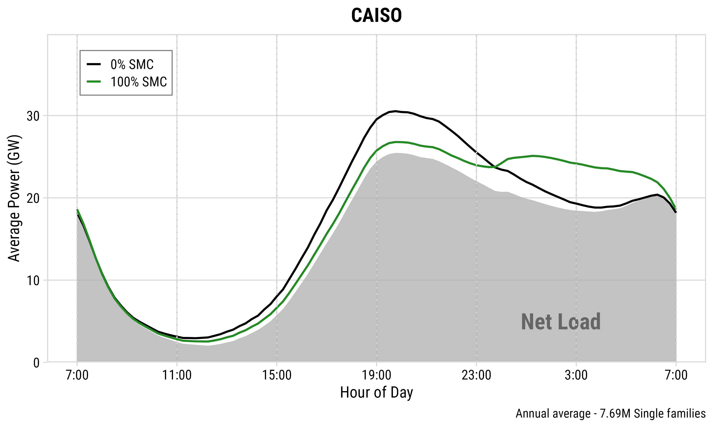</td>
      <td colspan="2" style="padding: 10px; text-align: center;">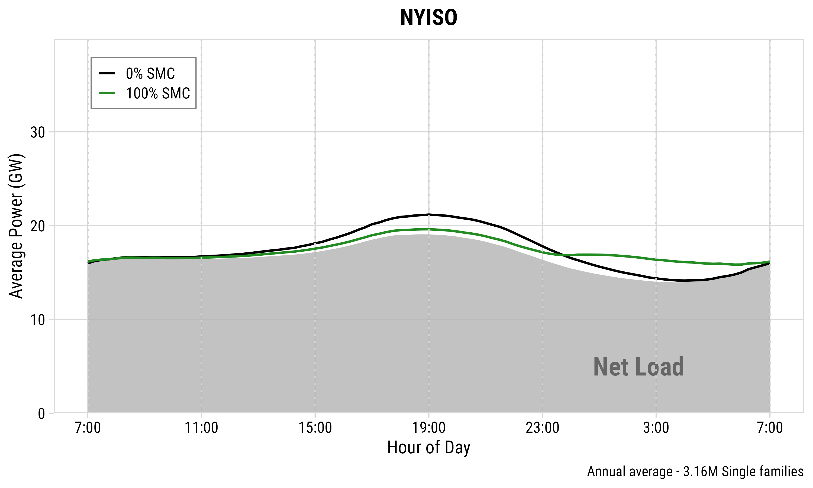</td>
    </tr>
    <tr>
      <td style="width: 17%; padding: 14px 10px; border-top: 1px solid #D4D3EE; border-right: 1px solid #D4D3EE; background-color: #EEEDF8;"><strong>Peak shave</strong></td>
      <td style="width: 33%; padding: 14px 10px; border-top: 1px solid #D4D3EE; border-right: 1px solid #D4D3EE; text-align: center;">3.7 GW (30.5 → 26.8)</td>
      <td style="width: 17%; padding: 14px 10px; border-top: 1px solid #D4D3EE; border-right: 1px solid #D4D3EE; background-color: #EEEDF8;"><strong>Peak shave</strong></td>
      <td style="width: 33%; padding: 14px 10px; border-top: 1px solid #D4D3EE; text-align: center;">1.6 GW (21.2 → 19.6)</td>
    </tr>
    <tr>
      <td style="padding: 14px 10px; border-top: 1px solid #D4D3EE; border-right: 1px solid #D4D3EE; background-color: #EEEDF8;"><strong>Percentage</strong></td>
      <td style="padding: 14px 10px; border-top: 1px solid #D4D3EE; border-right: 1px solid #D4D3EE; text-align: center;">12.1%</td>
      <td style="padding: 14px 10px; border-top: 1px solid #D4D3EE; border-right: 1px solid #D4D3EE; background-color: #EEEDF8;"><strong>Percentage</strong></td>
      <td style="padding: 14px 10px; border-top: 1px solid #D4D3EE; text-align: center;">7.5%</td>
    </tr>
  </tbody>
</table>

:::

::: {.notes}
Now the results. On an annual average day with full enrollment, SMC shaves 3.7 gigawatts off CAISO's evening peak, about 12 percent, and 1.6 gigawatts in NYISO, about 7.5 percent. CAISO does better both because it has more households and because its deep overnight valley absorbs the deferred charging.
:::

## Peak Shaving: [CAISO]{style="color: #ED6D46;"} Extreme Days {.light-centered .center}

::: {style="border: 1px solid #C7C1E5; border-radius: 14px; padding: 0; overflow: hidden; background: #FFFFFF; box-shadow: 0 14px 32px rgba(86, 84, 162, 0.12), 0 2px 6px rgba(44, 62, 80, 0.07);"}

<table style="width: 100%; border-collapse: collapse; font-size: 30px; margin: 0;">
  <thead>
    <tr style="background-color: #EEEDF8;">
      <th colspan="2" style="width: 50%; padding: 12px 10px; border-right: 1px solid #D4D3EE; border-bottom: 2px solid #C4C3E8; font-size: 32px; color: #2980B9; text-align: center;">Best Day (Jun 1)</th>
      <th colspan="2" style="width: 50%; padding: 12px 10px; border-bottom: 2px solid #C4C3E8; font-size: 32px; color: #E74C3C; text-align: center;">Worst Day (Dec 13)</th>
    </tr>
  </thead>
  <tbody>
    <tr>
      <td colspan="2" style="padding: 10px; border-right: 1px solid #D4D3EE; text-align: center;">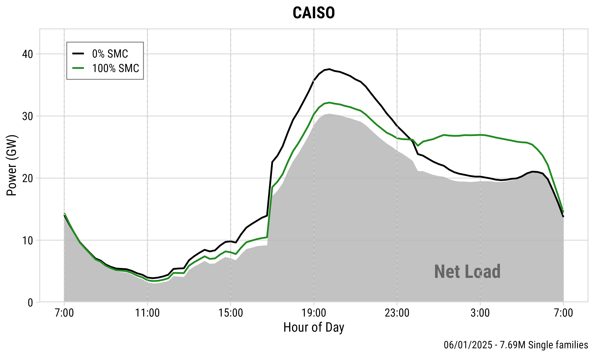</td>
      <td colspan="2" style="padding: 10px; text-align: center;">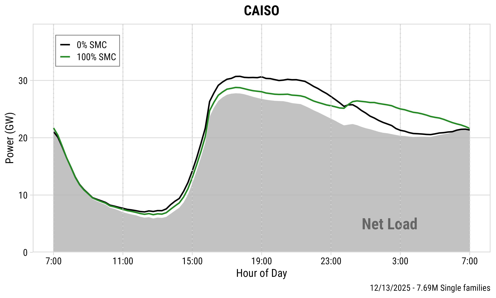</td>
    </tr>
    <tr>
      <td style="width: 17%; padding: 14px 10px; border-top: 1px solid #D4D3EE; border-right: 1px solid #D4D3EE; background-color: #EEEDF8;"><strong>Peak shave</strong></td>
      <td style="width: 33%; padding: 14px 10px; border-top: 1px solid #D4D3EE; border-right: 1px solid #D4D3EE; text-align: center;">5.4 GW (37.6 → 32.2)</td>
      <td style="width: 17%; padding: 14px 10px; border-top: 1px solid #D4D3EE; border-right: 1px solid #D4D3EE; background-color: #EEEDF8;"><strong>Peak shave</strong></td>
      <td style="width: 33%; padding: 14px 10px; border-top: 1px solid #D4D3EE; text-align: center;">1.9 GW (30.7 → 28.8)</td>
    </tr>
    <tr>
      <td style="padding: 14px 10px; border-top: 1px solid #D4D3EE; border-right: 1px solid #D4D3EE; background-color: #EEEDF8;"><strong>Percentage</strong></td>
      <td style="padding: 14px 10px; border-top: 1px solid #D4D3EE; border-right: 1px solid #D4D3EE; text-align: center;">14.4%</td>
      <td style="padding: 14px 10px; border-top: 1px solid #D4D3EE; border-right: 1px solid #D4D3EE; background-color: #EEEDF8;"><strong>Percentage</strong></td>
      <td style="padding: 14px 10px; border-top: 1px solid #D4D3EE; text-align: center;">6.2%</td>
    </tr>
  </tbody>
</table>

:::

::: {.notes}
Performance varies a lot day to day. CAISO's best day shaves 5.4 gigawatts, its worst under 2. One nuance: extreme days are ranked by how much peak can be shaved, not by how high the peak is. On heat-wave days, air conditioning dominates and BEV charging is a small share, so SMC has less leverage.
:::

## Peak Shaving: [NYISO]{style="color: #739C69;"} Extreme Days {.light-centered .center}

::: {style="border: 1px solid #C7C1E5; border-radius: 14px; padding: 0; overflow: hidden; background: #FFFFFF; box-shadow: 0 14px 32px rgba(86, 84, 162, 0.12), 0 2px 6px rgba(44, 62, 80, 0.07);"}

<table style="width: 100%; border-collapse: collapse; font-size: 30px; margin: 0;">
  <thead>
    <tr style="background-color: #EEEDF8;">
      <th colspan="2" style="width: 50%; padding: 12px 10px; border-right: 1px solid #D4D3EE; border-bottom: 2px solid #C4C3E8; font-size: 32px; color: #2980B9; text-align: center;">Best Day (Jul 13)</th>
      <th colspan="2" style="width: 50%; padding: 12px 10px; border-bottom: 2px solid #C4C3E8; font-size: 32px; color: #E74C3C; text-align: center;">Worst Day (Nov 8)</th>
    </tr>
  </thead>
  <tbody>
    <tr>
      <td colspan="2" style="padding: 10px; border-right: 1px solid #D4D3EE; text-align: center;">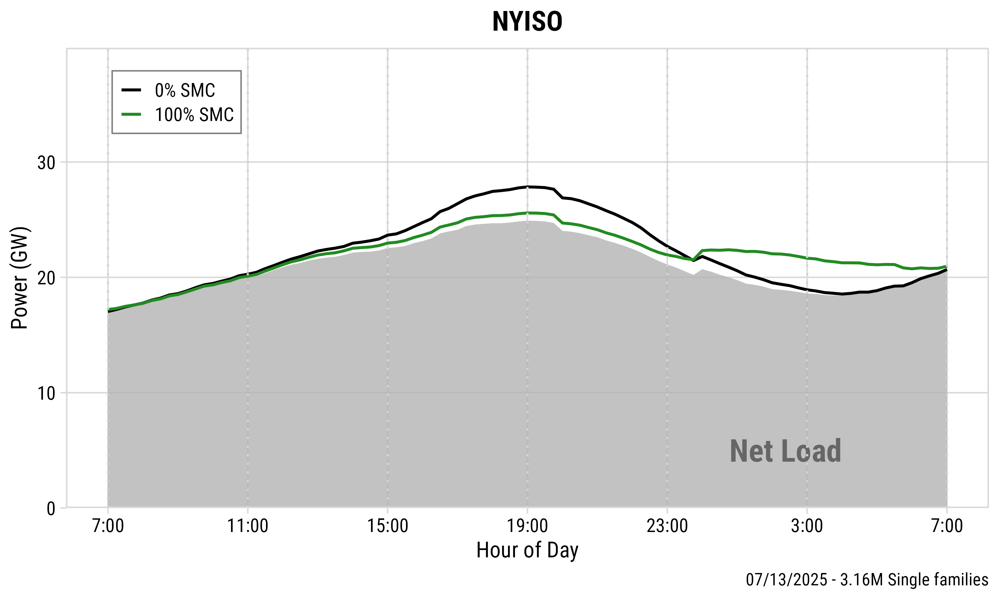</td>
      <td colspan="2" style="padding: 10px; text-align: center;">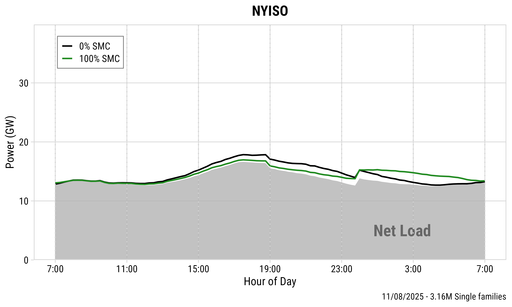</td>
    </tr>
    <tr>
      <td style="width: 17%; padding: 14px 10px; border-top: 1px solid #D4D3EE; border-right: 1px solid #D4D3EE; background-color: #EEEDF8;"><strong>Peak shave</strong></td>
      <td style="width: 33%; padding: 14px 10px; border-top: 1px solid #D4D3EE; border-right: 1px solid #D4D3EE; text-align: center;">2.2 GW (27.8 → 25.6)</td>
      <td style="width: 17%; padding: 14px 10px; border-top: 1px solid #D4D3EE; border-right: 1px solid #D4D3EE; background-color: #EEEDF8;"><strong>Peak shave</strong></td>
      <td style="width: 33%; padding: 14px 10px; border-top: 1px solid #D4D3EE; text-align: center;">0.8 GW (17.8 → 17.0)</td>
    </tr>
    <tr>
      <td style="padding: 14px 10px; border-top: 1px solid #D4D3EE; border-right: 1px solid #D4D3EE; background-color: #EEEDF8;"><strong>Percentage</strong></td>
      <td style="padding: 14px 10px; border-top: 1px solid #D4D3EE; border-right: 1px solid #D4D3EE; text-align: center;">7.9%</td>
      <td style="padding: 14px 10px; border-top: 1px solid #D4D3EE; border-right: 1px solid #D4D3EE; background-color: #EEEDF8;"><strong>Percentage</strong></td>
      <td style="padding: 14px 10px; border-top: 1px solid #D4D3EE; text-align: center;">4.5%</td>
    </tr>
  </tbody>
</table>

:::

::: {.notes}
NYISO's range is narrower: the best day shaves 2.2 gigawatts, the worst 0.8. Smaller absolute numbers because there are fewer households, and smaller percentages because the net load varies less over the day.
:::

## Seasonal Patterns: [CAISO]{style="color: #ED6D46;"} {.light-centered .center}

::: {style="border: 1px solid #C7C1E5; border-radius: 14px; padding: 0; overflow: hidden; background: #FFFFFF; box-shadow: 0 14px 32px rgba(86, 84, 162, 0.12), 0 2px 6px rgba(44, 62, 80, 0.07);"}

<table style="width: 100%; border-collapse: collapse; font-size: 28px; margin: 0;">
  <thead>
    <tr style="background-color: #EEEDF8;">
      <th style="width: 25%; padding: 12px 10px; border-right: 1px solid #D4D3EE; border-bottom: 2px solid #C4C3E8; font-size: 30px; text-align: center;">Spring</th>
      <th style="width: 25%; padding: 12px 10px; border-right: 1px solid #D4D3EE; border-bottom: 2px solid #C4C3E8; font-size: 30px; text-align: center;">Summer</th>
      <th style="width: 25%; padding: 12px 10px; border-right: 1px solid #D4D3EE; border-bottom: 2px solid #C4C3E8; font-size: 30px; text-align: center;">Fall</th>
      <th style="width: 25%; padding: 12px 10px; border-bottom: 2px solid #C4C3E8; font-size: 30px; text-align: center;">Winter</th>
    </tr>
  </thead>
  <tbody>
    <tr>
      <td style="padding: 6px; border-right: 1px solid #D4D3EE; text-align: center;">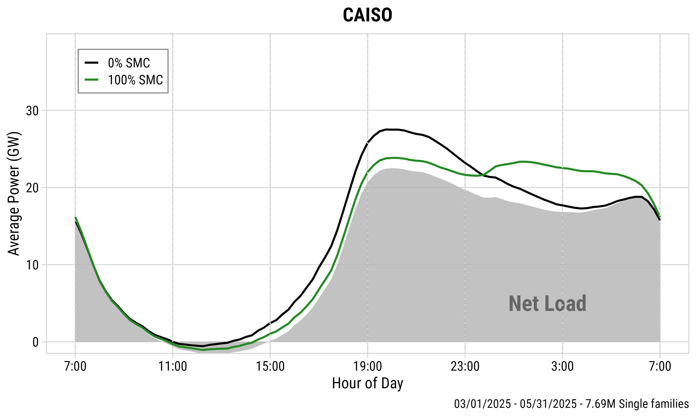</td>
      <td style="padding: 6px; border-right: 1px solid #D4D3EE; text-align: center;">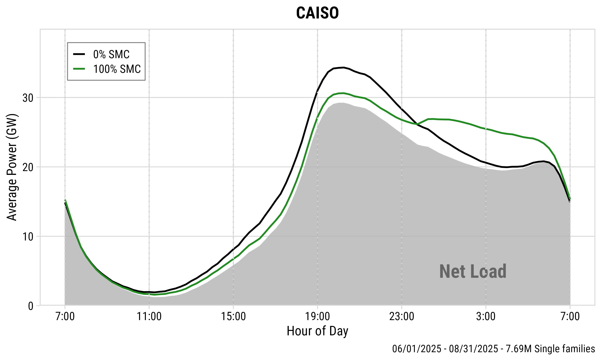</td>
      <td style="padding: 6px; border-right: 1px solid #D4D3EE; text-align: center;">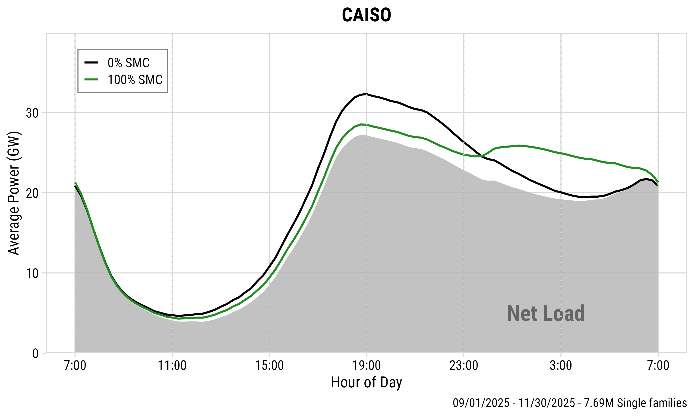</td>
      <td style="padding: 6px; text-align: center;">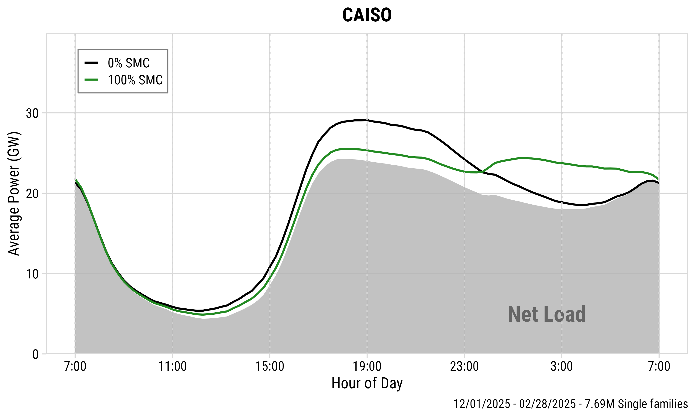</td>
    </tr>
    <tr>
      <td style="padding: 12px 6px; border-top: 1px solid #D4D3EE; border-right: 1px solid #D4D3EE; text-align: center; font-size: 24px;">3.7 GW (27.5 → 23.8)</td>
      <td style="padding: 12px 6px; border-top: 1px solid #D4D3EE; border-right: 1px solid #D4D3EE; text-align: center; font-size: 24px;">3.7 GW (34.3 → 30.6)</td>
      <td style="padding: 12px 6px; border-top: 1px solid #D4D3EE; border-right: 1px solid #D4D3EE; text-align: center; font-size: 24px;">3.8 GW (32.3 → 28.5)</td>
      <td style="padding: 12px 6px; border-top: 1px solid #D4D3EE; text-align: center; font-size: 24px;">3.6 GW (29.1 → 25.5)</td>
    </tr>
    <tr>
      <td style="padding: 12px 6px; border-top: 1px solid #D4D3EE; border-right: 1px solid #D4D3EE; text-align: center; font-size: 24px;">13.5%</td>
      <td style="padding: 12px 6px; border-top: 1px solid #D4D3EE; border-right: 1px solid #D4D3EE; text-align: center; font-size: 24px;">10.8%</td>
      <td style="padding: 12px 6px; border-top: 1px solid #D4D3EE; border-right: 1px solid #D4D3EE; text-align: center; font-size: 24px;">11.8%</td>
      <td style="padding: 12px 6px; border-top: 1px solid #D4D3EE; text-align: center; font-size: 24px;">12.4%</td>
    </tr>
    <tr>
      <td colspan="4" style="padding: 12px 10px; border-top: 1px solid #D4D3EE; text-align: center;">Peak shave for all seasons: <strong>3.6–3.8 GW (10.8–13.5%)</strong></td>
    </tr>
  </tbody>
</table>

:::

::: {.notes}
Seasonally, CAISO is remarkably consistent: 3.6 to 3.8 gigawatts in every season, because the solar-shaped profile keeps the peak-to-valley gap wide year-round. Summer has the highest absolute peak from air conditioning, but the shaving potential barely moves.
:::

## Seasonal Patterns: [NYISO]{style="color: #739C69;"} {.light-centered .center}

::: {style="border: 1px solid #C7C1E5; border-radius: 14px; padding: 0; overflow: hidden; background: #FFFFFF; box-shadow: 0 14px 32px rgba(86, 84, 162, 0.12), 0 2px 6px rgba(44, 62, 80, 0.07);"}

<table style="width: 100%; border-collapse: collapse; font-size: 28px; margin: 0;">
  <thead>
    <tr style="background-color: #EEEDF8;">
      <th style="width: 25%; padding: 12px 10px; border-right: 1px solid #D4D3EE; border-bottom: 2px solid #C4C3E8; font-size: 30px; text-align: center;">Spring</th>
      <th style="width: 25%; padding: 12px 10px; border-right: 1px solid #D4D3EE; border-bottom: 2px solid #C4C3E8; font-size: 30px; text-align: center;">Summer</th>
      <th style="width: 25%; padding: 12px 10px; border-right: 1px solid #D4D3EE; border-bottom: 2px solid #C4C3E8; font-size: 30px; text-align: center;">Fall</th>
      <th style="width: 25%; padding: 12px 10px; border-bottom: 2px solid #C4C3E8; font-size: 30px; text-align: center;">Winter</th>
    </tr>
  </thead>
  <tbody>
    <tr>
      <td style="padding: 6px; border-right: 1px solid #D4D3EE; text-align: center;">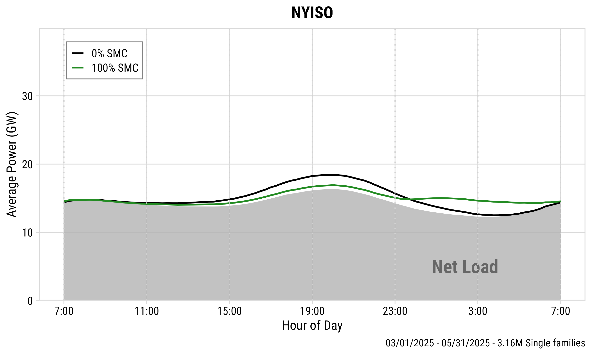</td>
      <td style="padding: 6px; border-right: 1px solid #D4D3EE; text-align: center;">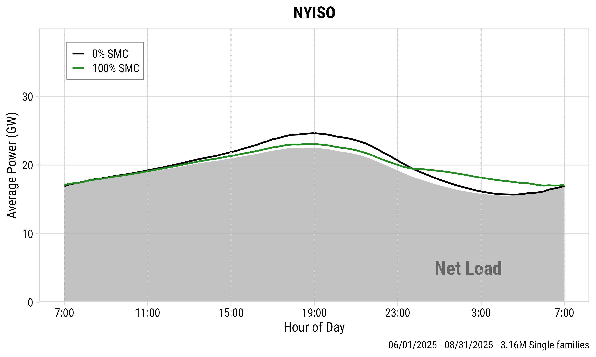</td>
      <td style="padding: 6px; border-right: 1px solid #D4D3EE; text-align: center;">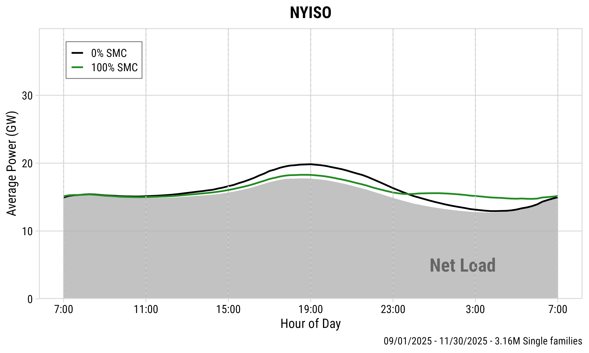</td>
      <td style="padding: 6px; text-align: center;">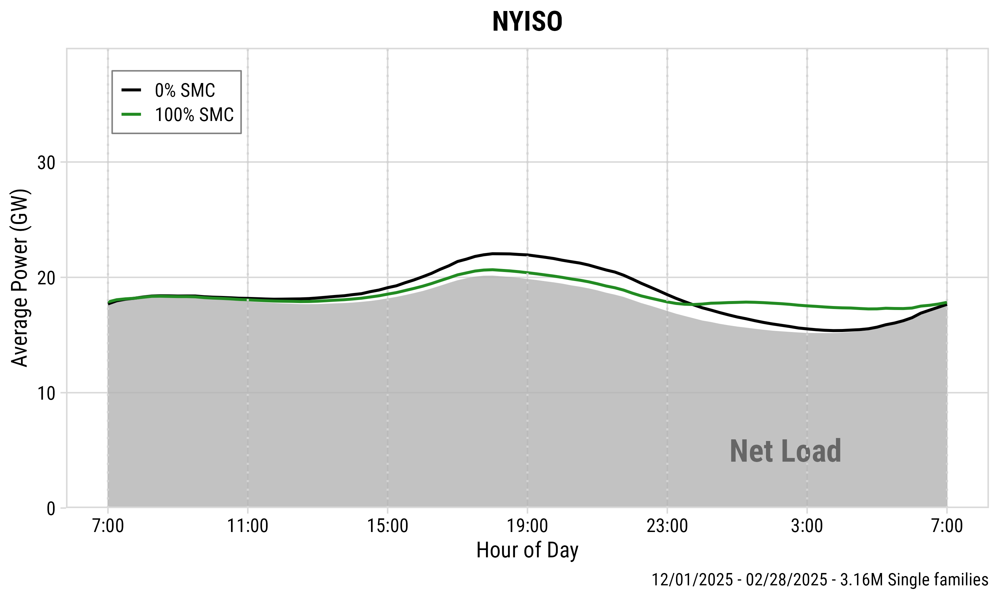</td>
    </tr>
    <tr>
      <td style="padding: 12px 6px; border-top: 1px solid #D4D3EE; border-right: 1px solid #D4D3EE; text-align: center; font-size: 24px;">1.5 GW (18.4 → 16.9)</td>
      <td style="padding: 12px 6px; border-top: 1px solid #D4D3EE; border-right: 1px solid #D4D3EE; text-align: center; font-size: 24px;">1.6 GW (24.6 → 23.0)</td>
      <td style="padding: 12px 6px; border-top: 1px solid #D4D3EE; border-right: 1px solid #D4D3EE; text-align: center; font-size: 24px;">1.5 GW (19.8 → 18.3)</td>
      <td style="padding: 12px 6px; border-top: 1px solid #D4D3EE; text-align: center; font-size: 24px;">1.4 GW (22.1 → 20.7)</td>
    </tr>
    <tr>
      <td style="padding: 12px 6px; border-top: 1px solid #D4D3EE; border-right: 1px solid #D4D3EE; text-align: center; font-size: 24px;">8.2%</td>
      <td style="padding: 12px 6px; border-top: 1px solid #D4D3EE; border-right: 1px solid #D4D3EE; text-align: center; font-size: 24px;">6.5%</td>
      <td style="padding: 12px 6px; border-top: 1px solid #D4D3EE; border-right: 1px solid #D4D3EE; text-align: center; font-size: 24px;">7.6%</td>
      <td style="padding: 12px 6px; border-top: 1px solid #D4D3EE; text-align: center; font-size: 24px;">6.3%</td>
    </tr>
    <tr>
      <td colspan="4" style="padding: 12px 10px; border-top: 1px solid #D4D3EE; text-align: center;">Peak shave for all seasons: <strong>1.4–1.6 GW (6.3–8.2%)</strong></td>
    </tr>
  </tbody>
</table>

:::

::: {.notes}
NYISO's winter is the exception: overnight space heating keeps the valley elevated, leaving less room for deferred charging and giving the smallest seasonal shaving at 1.4 gigawatts. The other three seasons cluster at 1.5 to 1.6.
:::

## Peak from BEV charging decreases with higher enrollment {.light-centered style="font-size: 0.85em;" .center}

{fig-align="center" width="100%" .purple-border}

::: {.notes}
Monthly incentive per household versus achieved peak reduction on the annual average day. Each dot is a 10 percent enrollment step. Peak reduction grows with enrollment in both regions, but the dots spread out along the incentive axis at higher enrollment. Joining this with the enrollment curve gives the cost efficiency frontier on the next slide.
:::

## Cost Efficiency Frontier {.light-centered .center}

::: {.columns}
::: {.column}
{fig-align="center" width="100%" .purple-border}
:::

::: {.column}
{fig-align="center" width="100%" .purple-border}
:::
:::

::: {style="text-align: center; font-size: 28px;"}
Cost efficiency is highest at moderate enrollment (**30–50%**).
:::

::: {.notes}
Here is the central result. We join the enrollment curve with the peak-shaving results. Each curve is one day type: least, average, and most peak shaving. Each dot is a 10 percent enrollment step, from 30 percent at zero incentive to 100 percent. The gray arrow shows the monthly incentive per household behind each dot, from 0 to 85 dollars. The dots stretch out along the cost axis: attracting marginal participants means raising the payment for every existing enrollee, so the last increments of enrollment are extremely expensive. Moderate enrollment, 30 to 50 percent, captures most of the achievable peak reduction at a fraction of the cost. And on about 15 percent of CAISO days, pushing enrollment too high actually creates a new overnight peak.
:::

## Seasonal cost efficiency is consistent in CAISO, but varies in NYISO. {.light-centered style="font-size: 0.85em;" .center}

::: {.columns}
::: {.column}
{fig-align="center" width="100%" .purple-border}
:::

::: {.column}
{fig-align="center" width="100%" .purple-border}
:::
:::

::: {.notes}
By season, CAISO's four curves nearly overlap, so a year-round program delivers consistent value: the solar-shaped profile keeps the peak-to-valley gap wide in every season. NYISO's winter curve sits below the others at every enrollment level, because overnight space heating keeps the valley elevated and leaves less room for deferred charging. Utilities there may need seasonal enrollment targets or incentive levels.
:::

## Cost efficiency across BEV adoption rates {.light-centered .center}

::: {.columns}
::: {.column}
{fig-align="center" width="100%" .purple-border}
:::

::: {.column}
{fig-align="center" width="100%" .purple-border}
:::
:::

::: {.notes}
The 1:1 BEV-to-household ratio is a near upper bound of adoption. At 1:2 and 1:4, the frontiers keep the same shape with proportionally smaller peak shaving and cost, so the moderate-enrollment conclusion holds at lower adoption as well.
:::

## Most program cost is participant surplus {.light-centered .center}

{fig-align="center" width="92%" .purple-border}

::: {style="text-align: center; font-size: 28px;"}
**72–92%** of uniform payments exceed what enrolled households would accept.
:::

::: {.notes}
One more angle on cost. The program pays the same incentive to every enrolled household, but the enrollment curve tells us each household's minimum: roughly a third would join for nothing. The dashed line is what the program would pay if each household got exactly its minimum. The gap is participant surplus, and it is 72 to 92 percent of program cost. At 60 percent enrollment in CAISO, the program pays 92 million a month, while the enrolled households would accept 21 million. No program can pay the minimum, since each household's number is private, but it bounds what tiered menus or enrollment auctions could save.
:::

## How Do Pilot Programs Compare? {.light-centered .center}

::: {style="border: 1px solid #C7C1E5; border-radius: 14px; padding: 0; overflow: hidden; background: #FFFFFF; box-shadow: 0 14px 32px rgba(86, 84, 162, 0.12), 0 2px 6px rgba(44, 62, 80, 0.07);"}

<table style="width: 100%; border-collapse: collapse; font-size: 26px; margin: 0;">
  <thead>
    <tr style="background-color: #EEEDF8;">
      <th style="width: 36%; padding: 12px 10px; border-right: 1px solid #D4D3EE; border-bottom: 2px solid #C4C3E8; font-size: 28px; text-align: center;">Program</th>
      <th style="width: 34%; padding: 12px 10px; border-right: 1px solid #D4D3EE; border-bottom: 2px solid #C4C3E8; font-size: 28px; text-align: center;">Incentive</th>
      <th style="width: 30%; padding: 12px 10px; border-bottom: 2px solid #C4C3E8; font-size: 28px; text-align: center;">Enrollment</th>
    </tr>
  </thead>
  <tbody>
    <tr>
      <td style="padding: 14px 10px; border-right: 1px solid #D4D3EE; text-align: center;">PCE Managed Charging (CAISO)</td>
      <td style="padding: 14px 10px; border-right: 1px solid #D4D3EE; text-align: center;">$0 → $40 per month</td>
      <td style="padding: 14px 10px; text-align: center;">1.4% → 10.6%</td>
    </tr>
    <tr>
      <td style="padding: 14px 10px; border-top: 1px solid #D4D3EE; border-right: 1px solid #D4D3EE; text-align: center;">MCE Sync (CAISO)</td>
      <td style="padding: 14px 10px; border-top: 1px solid #D4D3EE; border-right: 1px solid #D4D3EE; text-align: center;">$50 bonus + $10 per month</td>
      <td style="padding: 14px 10px; border-top: 1px solid #D4D3EE; text-align: center;">10% of serviceable market</td>
    </tr>
    <tr>
      <td style="padding: 14px 10px; border-top: 1px solid #D4D3EE; border-right: 1px solid #D4D3EE; text-align: center;">SmartCharge New York (NYISO)</td>
      <td style="padding: 14px 10px; border-top: 1px solid #D4D3EE; border-right: 1px solid #D4D3EE; text-align: center;">Up to $400 per year</td>
      <td style="padding: 14px 10px; border-top: 1px solid #D4D3EE; text-align: center;">~7% of registered EVs (731 vehicles)</td>
    </tr>
  </tbody>
</table>

:::

 

::: {style="text-align: center; font-size: 28px;"}
- Smart charging programs motivated EV owners to **charge off-peak**.
- More incentive results in more enrollment.
- Stated preference surveys are not calibrated against current pilot programs.
:::

::: {.notes}
Three deployed pilot programs: two in CAISO territory, one in NYISO [@pce_ev_managed_charging_2025; @mce_sync_2024; @coned_smartcharge_2019].

First, they motivated EV owners to charge off-peak: MCE Sync cut charging in the 4-to-9 PM window by nearly 90 percent.

Second, more incentive means more enrollment. PCE's randomized pilot shows this directly: 1.4 percent with no payment, rising to 10.6 percent at 40 dollars a month.

Third, real enrollment sits around 4 to 10 percent, below our 30 to 50 percent target. Stated preference overstates real behavior, and these pilots are small and short, so they carry their own biases. The survey gives an optimistic upper bound, but the field data confirms the direction the model predicts.
:::

## Conclusions {.light-centered .center}

::: {style="border: 1px solid #C7C1E5; border-radius: 14px; padding: 0; overflow: hidden; background: #FFFFFF; box-shadow: 0 14px 32px rgba(86, 84, 162, 0.12), 0 2px 6px rgba(44, 62, 80, 0.07);"}

<table style="width: 100%; border-collapse: collapse; font-size: 28px; margin: 0;">
  <tbody>
    <tr>
      <td colspan="2" style="padding: 16px 14px; text-align: left;">1\. <strong style="color: #ED6D46;">Peak-shaving</strong> potential is: up to 14.4% (5.4 GW) for CAISO, and 7.9% (2.2 GW) for NYISO.</td>
    </tr>
    <tr>
      <td colspan="2" style="padding: 16px 14px; border-top: 1px solid #D4D3EE; text-align: left;">2\. The <strong style="color: #2980B9;">cost-effectiveness</strong> of peak shaving requires: moderate enrollment (30–50%), and seasonal effect consideration.</td>
    </tr>
    <tr>
      <td colspan="2" style="padding: 16px 14px; border-top: 1px solid #D4D3EE; text-align: left;">3\. Most program cost is <strong style="color: #739C69;">participant surplus</strong> (72–92%): better-targeted incentives could deliver the same shaving for less.</td>
    </tr>
    <tr>
      <td style="width: 20%; padding: 16px 14px; border-top: 1px solid #D4D3EE; border-right: 1px solid #D4D3EE; background-color: #EEEDF8; text-align: center;"><strong style="color: #F07167;">Limitations</strong></td>
      <td style="width: 80%; padding: 16px 14px; border-top: 1px solid #D4D3EE; text-align: left;">a\. Stated preference might be optimistic. b\. Only considered single-family homes. c\. Grid conditions based on 2025 data.</td>
    </tr>
  </tbody>
</table>

:::

::: {.notes}
Three takeaways. First, the magnitude: SMC shaves up to 14.4 percent off CAISO's evening peak and 7.9 percent off NYISO's. CAISO does better because its deep overnight valley absorbs the deferred charging.

Second, cost. Returns to enrollment diminish sharply: 30 to 50 percent participation captures most of the achievable reduction at a fraction of the cost, and pushing too high can create a new overnight peak. Utilities should design SMC programs around moderate enrollment targets, not maximum participation, and in NYISO account for weaker winter performance.

Third, most of what a uniform incentive pays is participant surplus, so better-targeted designs could lower the cost of the same peak shaving.

Beyond these, SMC has co-benefits we did not monetize: lower marginal emissions, longer battery life, and deferred capacity investment, so the frontiers are a lower bound on its value. And as grid storage grows, SMC stays a complement: storage reshapes the baseline, SMC removes the peak that BEV charging adds on top.

Limitations: the enrollment curve is stated preference, so it may overstate real uptake and our costs may be a lower bound. We model single-family homes only, which matters for New York City. And results are calibrated to 2025 net load.
:::
